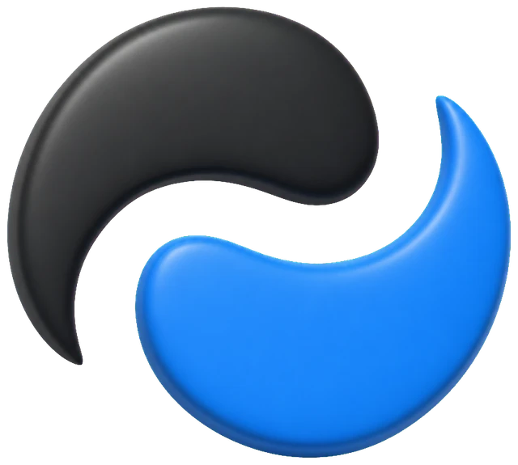
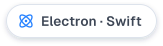
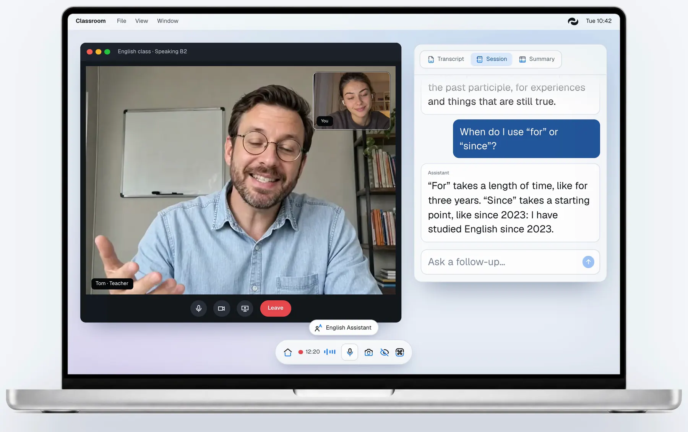
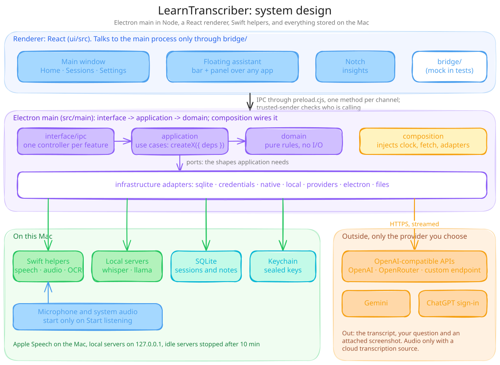

<p align="center">
  <picture>
    <source media="(prefers-color-scheme: dark)" srcset="docs/readme/wordmark-dark.svg">
    
  </picture>
</p>

<p align="center">
  
</p>

<h1 align="center">Lee lo que oyes. Pregunta mientras escuchas.</h1>

<p align="center">
  <a href="README.md">English</a> · <a href="README.pt-BR.md">Português</a> · <b>Español</b>
</p>

<p align="center">
  <strong>Transcripción en vivo de clases, vídeos y reuniones en tu Mac,<br>
  con un asistente flotante al que puedes preguntar sobre lo que se dijo.</strong><br>
  Gratis y de código abierto. La voz puede quedarse en tu Mac con Apple Speech, las respuestas vienen de la IA que
  elijas y cada sesión se guarda en tu Mac.
</p>

<p align="center">
  <a href="LICENSE"></a>
  <a href="#requisitos"></a>
  <a href="#requisitos"></a>
  <a href="#cómo-funciona"></a>
</p>

<p align="center">
  <a href="https://github.com/DeVFirmino/learntranscriber/actions/workflows/ci.yml"></a>
  <a href="https://github.com/DeVFirmino/learntranscriber/actions/workflows/codeql.yml"></a>
  <a href="https://www.coderabbit.ai"></a>
  <a href="CONTRIBUTING.md"></a>
</p>

<p align="center">
  <a href="https://learntranscriber.danieldias.dev"></a>
  <a href="#descarga"></a>
  <a href="#instalar-con-tu-agente"></a>
  <a href="#cómo-contribuir"></a>
  <a href="https://buymeacoffee.com/dellphell"></a>
</p>

> **En resumen** — Una app gratis y de código abierto para Mac que escribe, en vivo, lo que oyes en una clase, un vídeo
> o una reunión, y responde a tus preguntas sobre eso en un panel flotante. La voz se puede transcribir por completo en
> tu Mac con Apple Speech; las respuestas vienen de la IA que elijas: el inicio de sesión de ChatGPT, una clave de API o
> un modelo local. Para Macs con Apple Silicon y macOS 14 o posterior. Descárgala, compílala desde el código fuente o
> deja que tu agente de programación la instale por ti.

<p align="center">
  
</p>

<sub>Esta es una traducción del [README en inglés](README.md). Si algo no coincide, vale el inglés.</sub>

## Contenido

- [Qué hace](#qué-hace)
- [Descarga](#descarga)
- [Instalar con tu agente](#instalar-con-tu-agente)
- [Primer uso](#primer-uso)
- [Cómo funciona](#cómo-funciona)
- [Asistentes](#asistentes)
- [Requisitos](#requisitos)
- [Compilar desde el código fuente](#compilar-desde-el-código-fuente)
- [Privacidad](#privacidad)
- [Atajos de teclado](#atajos-de-teclado)
- [Cómo contribuir](#cómo-contribuir)
- [Preguntas frecuentes](#preguntas-frecuentes)
- [Hecho con](#hecho-con)
- [Apoyo y licencia](#apoyo-y-licencia)

## Qué hace

- **Transcripción en vivo.** Mientras transcurre una clase, una reunión o un vídeo, las palabras aparecen a medida que
  la gente habla. Vienen de Apple Speech en el Mac, de un servidor Whisper local o de un servicio de transcripción en
  la nube, el que configures.
- **Pregunta sobre lo que se dijo.** Un panel flotante queda sobre cualquier app. Haz una pregunta y la respuesta llega
  poco a poco, basada en la transcripción. Una captura de pantalla o el texto que seleccionaste puede ir con la
  pregunta.
- **Un asistente para cada momento.** Inglés, Matemáticas, Programación, un tomador de notas para reuniones y un
  asistente general vienen con la app, y puedes crear los tuyos.
- **Historial de sesiones.** Vuelve a abrir transcripciones y respuestas, genera un resumen o guarda una nota en
  Markdown.
- **Proveedores de respuestas.** Inicia sesión con ChatGPT, usa una clave de API de OpenAI, OpenRouter o Gemini,
  conecta un endpoint propio compatible con OpenAI, o descarga y ejecuta un modelo local.

## Descarga

[Descarga el DMG más reciente](https://github.com/DeVFirmino/learntranscriber/releases/latest/download/LearnTranscriber-arm64.dmg)
desde [GitHub Releases](https://github.com/DeVFirmino/learntranscriber/releases/latest), para Macs con Apple Silicon y
macOS 14 o posterior, y arrastra LearnTranscriber a Aplicaciones.

La app no está notarizada por Apple, así que macOS bloquea la primera apertura: abre **Ajustes del Sistema →
Privacidad y seguridad**, desplázate hasta Seguridad, elige **Abrir igualmente** junto a LearnTranscriber y confirma
con tu contraseña ([instrucciones de Apple](https://support.apple.com/es-es/guide/mac-help/mchleab3a043/mac)).
Instala una versión nueva de la misma forma, encima de la anterior; tus sesiones y ajustes se conservan.

También puedes [compilarla desde el código fuente](#compilar-desde-el-código-fuente) o dejar que
[tu agente de programación](#instalar-con-tu-agente) la instale.

## Instalar con tu agente

Si usas un agente de programación como Claude Code o Codex, envíale el enlace de este repositorio y pídele que instale
la app, o pega esto:

```text
Instala LearnTranscriber en este Mac desde https://github.com/DeVFirmino/learntranscriber.
Clona el repositorio y sigue la sección "Compilar desde el código fuente" del README.es.md: comprueba que estén
instalados Xcode con el SDK de macOS 26 y Node.js 24 o posterior, ejecuta `npm ci` y `npm ci --prefix ui`, compila la
app con `npm run pack`, copia dist/mac-arm64/LearnTranscriber.app a /Applications y ábrela. Si macOS la bloquea,
avísame para que elija Abrir igualmente en Ajustes del Sistema → Privacidad y seguridad.
```

El agente puede hacerlo todo salvo la primera apertura: ahí, macOS te pide cada permiso y, en una compilación sin
Developer ID, el **Abrir igualmente**.

## Primer uso

Tras la pantalla de bienvenida, la configuración guiada recorre cuatro pasos. **Omitir por ahora** cierra la
configuración, y **Continuar configuración** en Inicio la vuelve a abrir.

1. **Elige la IA que responde:** inicia sesión con ChatGPT, pega una clave de API o descarga un modelo local. El paso
   comprueba la conexión y elige un modelo antes de seguir.
2. **Configura la escucha:** prueba el micrófono con el nivel en vivo y elige una fuente de audio y un motor de
   transcripción. La configuración empieza con el audio del ordenador junto al micrófono y con Apple Speech en el
   propio Mac.
3. **Concede los permisos:** la configuración te guía por los permisos que piden tus elecciones, uno a la vez.
4. **Prueba una sesión:** la barra y el panel flotantes te muestran cómo empezar la captura, ver la transcripción y
   hacer una pregunta. Si la configuración está incompleta, puedes reproducir una conversación de ejemplo.

## Cómo funciona

<p align="center">
  
</p>

La app es un proceso principal de Electron escrito en Node, un renderer de React y un conjunto de pequeños helpers en
Swift.

- **Renderer** (`ui/src`): la ventana principal (Inicio, Sesiones, Ajustes), el asistente flotante (una barra y un
  panel sobre cualquier app) y el Notch. Solo habla con el proceso principal a través de `bridge/`, que tiene un método
  por cada canal de IPC en `src/main/preload.cjs`; las pruebas ejecutan las mismas pantallas con un bridge simulado.
- **Proceso principal** (`src/main`): `interface/ipc` tiene un controller ligero por funcionalidad, `application`
  guarda los casos de uso como factories `createX({ deps })` y `domain` guarda reglas puras, sin E/S. Los adaptadores
  de `infrastructure` tocan el mundo (SQLite, el Llavero, los helpers nativos, los servidores locales, los
  proveedores), y `composition` lo conecta todo e inyecta el reloj, `fetch` y los adaptadores. El contrato completo
  está en [AGENTS.md](AGENTS.md).
- **Helpers en Swift** (`native/`): Apple Speech para transcribir en el propio Mac, ScreenCaptureKit y Core Audio para
  el audio del ordenador y Vision para el texto en pantalla. Cada uno es un comando pequeño que el proceso principal
  inicia y con el que habla por stdin y stdout.
- **En el Mac**: sesiones y notas en SQLite dentro de la carpeta Application Support de la app, claves de los
  proveedores protegidas con el `safeStorage` de Electron (el Llavero de macOS) y, si quieres, procesos
  `whisper-server` / `llama-server` vinculados a `127.0.0.1`.
- **Fuera del Mac**: solo los servicios que elegiste. El audio solo sale del Mac con una fuente de transcripción en la
  nube.

Una sesión, paso a paso:

1. Elige un asistente en la barra flotante.
2. Pulsa **Empezar a escuchar** (⌘D). El micrófono, y el audio del ordenador si lo activaste, empiezan solo ahora, y
   la transcripción se va llenando a medida que la gente habla.
3. Pregunta en el panel flotante (⌘Return). La transcripción, tu pregunta y, si la adjuntaste, una captura de pantalla
   (⌘E) o un texto seleccionado (⌘⇧K) van a tu proveedor de respuestas, y la respuesta llega poco a poco.
4. Deja de escuchar. La sesión guarda la transcripción y las respuestas en Sesiones, donde puedes generar un resumen o
   guardar una nota en Markdown.

## Asistentes

<p align="center">
  
</p>

| Asistente | Categoría | Qué hace |
| --- | --- | --- |
| English Assistant | Educación | Explica gramática, vocabulario y formas más claras de decir algo. |
| Math Assistant | Educación | Resuelve problemas paso a paso, del colegio a la universidad. |
| Programming Assistant | Educación | Explica código y conceptos, con ejemplos que puedes ejecutar. |
| Note Taker | Reuniones | Anota decisiones, tareas y preguntas abiertas durante la reunión. |
| General Assistant | General | Explica cualquier tema, desde un resumen rápido hasta los detalles. |

Esos cinco vienen con la app. Tus propios asistentes se crean en la página Asistentes con un nombre, una categoría y un
prompt, y aparecen en la barra flotante junto a los que vienen con la app.

## Requisitos

- Un Mac con Apple Silicon y macOS 14 o posterior. Las compilaciones son solo arm64. Instalar o liberar idiomas de
  Apple Speech requiere macOS 26.
- Acceso a Micrófono para captar la voz, a Reconocimiento de voz para Apple Speech y a Grabación de pantalla y audio
  del sistema para captar la pantalla. Leer texto seleccionado en otras apps puede requerir acceso de Accesibilidad.
- Un proveedor de respuestas configurado para preguntas y resúmenes.
- [Homebrew](https://brew.sh), solo si quieres que la app instale `llama-server` o `whisper-server` por ti.

La app busca versiones nuevas en GitHub. Instala las actualizaciones a mano, encima de la compilación anterior, para
conservar tus sesiones y ajustes.

## Compilar desde el código fuente

1. **Instala Xcode** con el SDK de macOS 26 y Swift 6.2 o posterior. Las Command Line Tools equivalentes bastan para
   compilar los helpers. Usa Xcode para ejecutar las pruebas en Swift.
2. **Instala Node.js** 24 o posterior. Las herramientas de compilación y de pruebas se ejecutan en Node.js, y las
   pruebas del backend usan su módulo SQLite integrado.
3. **Clona este repositorio** e instala los dos conjuntos de dependencias:

   ```sh
   npm ci
   npm ci --prefix ui
   ```

4. **Ejecuta la app:**

   ```sh
   npm start
   ```

   Esto compila el renderer y los helpers en Swift y luego abre la app.

5. **Empaquétala** cuando quieras usarla fuera del flujo de desarrollo:

   ```sh
   npm run pack   # dist/mac-arm64/LearnTranscriber.app
   npm run dmg    # dist/distribution-local/LearnTranscriber-<versión>-arm64-local.dmg
   npm run sbom   # dist/LearnTranscriber-<versión>-sbom.cdx.json, la lista de lo que lleva la app
   ```

   Las dos compilaciones son personales: sin firma Developer ID y sin notarización. El empaquetado usa primero un
   certificado Apple Development instalado, luego una identidad local autofirmada y, por último, ninguna firma; consulta
   la [firma local](docs/local-signing.md).

6. **Abre tu compilación.** Si Gatekeeper la bloquea, sigue las
   [instrucciones de Apple para abrir una app](https://support.apple.com/es-es/guide/mac-help/mchleab3a043/mac) con
   **Ajustes del Sistema → Privacidad y seguridad → Abrir igualmente**.

## Privacidad

- Una sesión de escucha capta las fuentes de audio activadas. Ocultar las ventanas deja la captura en marcha; usa
  **Dejar de escuchar** para detenerla. Las pruebas de micrófono de la configuración y de Ajustes abren el micrófono
  para mostrar el nivel en vivo.
- Apple Speech y Whisper local transcriben el audio en el Mac. La transcripción en la nube envía el audio al servicio
  elegido.
- Las peticiones de respuesta pueden enviar partes de la transcripción, texto seleccionado o capturas de pantalla al
  proveedor configurado. **Análisis rápido de captura** viene activado y envía una captura cuando haces una. El
  análisis automático de la pantalla puede enviar una captura al empezar la sesión o tras una selección. **Analizar
  selecciones copiadas**, activado por defecto, puede enviar el texto copiado que coincida con una selección en otra
  app durante una sesión. Los endpoints remotos usan HTTPS; los locales pueden usar HTTP en loopback.
- Las claves de los proveedores se cifran con el `safeStorage` de Electron, respaldado por el Llavero de macOS, y las
  pantallas de la app pueden guardar una clave, pero nunca volver a leerla.
- Las sesiones y los ajustes están en una base de datos SQLite local, en la carpeta Application Support de la app, que
  solo tu usuario de macOS puede leer. La app no la cifra: FileVault cifra el disco, y las copias de seguridad como
  Time Machine guardan sus propias copias.
- Los errores y avisos van a un registro en `~/Library/Logs/LearnTranscriber`, que solo tu usuario puede leer y que se
  limita a dos archivos. Los formatos comunes de claves y tokens se ocultan, pero lee el registro antes de compartirlo.
- La app pregunta a GitHub si hay una versión nueva como mucho una vez al día, a partir de unos 15 segundos después de
  abrirse. La petición lleva la versión de la app y, como cualquier petición, tu dirección IP; no envía transcripción,
  ajustes ni claves.
- Descargar un modelo local de Hugging Face, un servidor con Homebrew o un idioma de Apple Speech usa la red.
- Los procesos `whisper-server` y `llama-server` que gestiona la app se vinculan a `127.0.0.1` y se detienen tras 10
  minutos sin uso. `llama-server` exige una clave de API nueva en cada arranque; `whisper-server` no tiene opción de
  autenticación, así que depende de escuchar solo en loopback. Las descargas de modelos que no superan la verificación
  SHA-256 se descartan.
- La protección contra capturas viene activada. Las apps que usan ScreenCaptureKit aún pueden capturar una ventana
  protegida
  ([Electron lo documenta](https://www.electronjs.org/docs/latest/api/browser-window#winsetcontentprotectionenable-macos-windows)).
  Comparte una ventana en lugar de toda la pantalla y comprueba lo que ven los asistentes a la llamada.

## Atajos de teclado

Cambia estos atajos globales en Ajustes → Atajos.

| Atajo | Acción |
| --- | --- |
| ⌘D | Iniciar escucha / analizar conversación |
| ⌘Return | Preguntar / enviar pregunta |
| ⌘E | Capturar pantalla |
| ⌘⇧K | Leer texto seleccionado |
| ⌘⇧D | Silenciar / activar micrófono |
| ⌘B | Ocultar / restaurar todas las ventanas |
| ⌘M | Mostrar/ocultar asistente flotante |
| ⌘⇧I | Activar/desactivar clic a través |

## Cómo contribuir

LearnTranscriber es de código abierto, y las contribuciones de cualquier tamaño son bienvenidas: un informe de error,
una traducción, un asistente mejor, una documentación más clara o un pull request. [CONTRIBUTING.md](CONTRIBUTING.md)
tiene los detalles, y las vulnerabilidades se envían en privado a través de [SECURITY.md](SECURITY.md), nunca en una
issue pública.

### Formas de ayudar

- **Informa de un error.** Abre una issue con tu versión de macOS y tu modelo de Mac, los pasos, lo que esperabas y lo
  que pasó, y las líneas relevantes de `~/Library/Logs/LearnTranscriber/main.log`, sin nada privado.
- **Propón una funcionalidad.** Abre una issue que cuente cuándo la usarías. Para algo más grande que un arreglo
  pequeño, acuerda el cambio en la issue antes de construirlo.
- **Traduce la app.** Todos los textos que muestra la app están en [`ui/src/locales/`](ui/src/locales) (`en`, `pt-BR`,
  `es`). Los catálogos mantienen las mismas claves, algo que comprueba [`ui/test/i18n.test.cjs`](ui/test/i18n.test.cjs);
  un idioma nuevo es un catálogo nuevo con todas las claves.
- **Mejora un asistente.** Los [asistentes que vienen con la app](src/main/domain/assistants/built-ins) están en un
  archivo cada uno.
- **Haz la documentación más clara.** Este README y sus versiones en [inglés](README.md) y [portugués](README.pt-BR.md),
  [CONTRIBUTING.md](CONTRIBUTING.md), el [inventario de funcionalidades](docs/features.md), el
  [sistema de diseño](docs/design-system.md) y las [notas de integración de la UI](docs/UI_INTEGRATION.md).

### Estructura del proyecto

```
src/main/      proceso principal de Electron: domain, application, infrastructure, interface/ipc, composition
ui/src/        renderer de React: pages, features, components, settings, locales; bridge/ es el único contacto con Electron
native/        helpers en Swift: HelperKit, CommandKit, <Area>Core, <Area>Adapters, un comando ligero cada uno
test/, ui/test/, native/Tests/   node:test, node:test sobre TS transpilado, Swift Testing
docs/          inventario de funcionalidades, notas de diseño e informes de verificación
```

Lee [AGENTS.md](AGENTS.md) antes de tu primer cambio. Es el contrato del proyecto: las dependencias apuntan
`interface → application → domain`, los módulos reciben lo que usan en lugar de importarlo, cada módulo tiene una
responsabilidad en unas 150 líneas, los cambios de esquema son migraciones numeradas y cada módulo nuevo llega con una
prueba enfocada.

### Antes de abrir un pull request

```sh
npm test          # backend
npm run ui:test   # lógica del renderer
npm run check     # sintaxis, prettier, oxlint
npm run ui:build  # tsc + vite
```

Si cambió `native/`, ejecuta también `cd native && swift build -c release && swift test`. Mantén cada commit en un solo
tema, con un título corto en inglés y en imperativo, y en el pull request explica qué cambia y cómo lo comprobaste, con
capturas de antes y después para cualquier cambio visual.

## Preguntas frecuentes

**¿Es gratis?** La app es gratis y tiene licencia MIT. Las respuestas vienen de la IA que conectes: un plan de ChatGPT
que ya tengas, una clave de API que el proveedor cobra por uso, o un modelo local, que no cuesta nada.

**¿Mi audio sale de mi Mac?** Solo con una fuente de transcripción en la nube. Apple Speech y Whisper local transcriben
en el Mac.

**¿Qué envía una pregunta?** La transcripción, tu pregunta y lo que adjuntaste van a tu proveedor de respuestas, salvo
que sea un modelo local. Consulta [Privacidad](#privacidad) para los valores por defecto de capturas y selecciones.

**¿Funciona en Macs Intel o en Windows?** No. Las compilaciones son para Macs con Apple Silicon y macOS 14 o
posterior.

**¿La gente de una llamada puede verla cuando comparto la pantalla?** Puede que sí: la protección contra capturas no
detiene ScreenCaptureKit (consulta [Privacidad](#privacidad)), así que comparte una sola ventana cuando puedas.

## Hecho con

[Electron](https://www.electronjs.org), [React](https://react.dev), [Vite](https://vite.dev),
[Tailwind CSS](https://tailwindcss.com), [Radix UI](https://www.radix-ui.com) y [shadcn/ui](https://ui.shadcn.com),
iconos [Lucide](https://lucide.dev), [react-markdown](https://github.com/remarkjs/react-markdown),
[highlight.js](https://highlightjs.org), [PDF.js](https://mozilla.github.io/pdf.js/),
[Sonner](https://sonner.emilkowal.ski) y la tipografía [Geist](https://vercel.com/font).
[whisper.cpp](https://github.com/ggml-org/whisper.cpp) y [llama.cpp](https://github.com/ggml-org/llama.cpp) ejecutan
los modelos locales, [webrtcaec3.js](https://github.com/ennuicastr/webrtcaec3.js) aporta el cancelador de eco de
WebRTC, y los frameworks Speech, ScreenCaptureKit y Vision de Apple hacen el trabajo en el propio Mac.

## Apoyo y licencia

Si LearnTranscriber te ayuda a estudiar o a trabajar, dale una estrella al repositorio, cuéntaselo a alguien o
[invítame un café](https://buymeacoffee.com/dellphell). LearnTranscriber se publica bajo la [Licencia MIT](LICENSE).

<p align="center">
  <a href="https://danieldias.dev"></a>
</p>

<p align="center">
  <a href="https://learntranscriber.danieldias.dev">learntranscriber.danieldias.dev</a> ·
  <a href="https://danieldias.dev">danieldias.dev</a> · <a href="https://github.com/DeVFirmino">GitHub</a>
</p>
