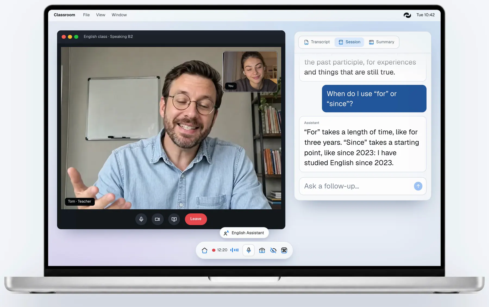
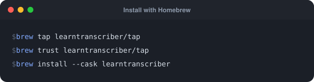
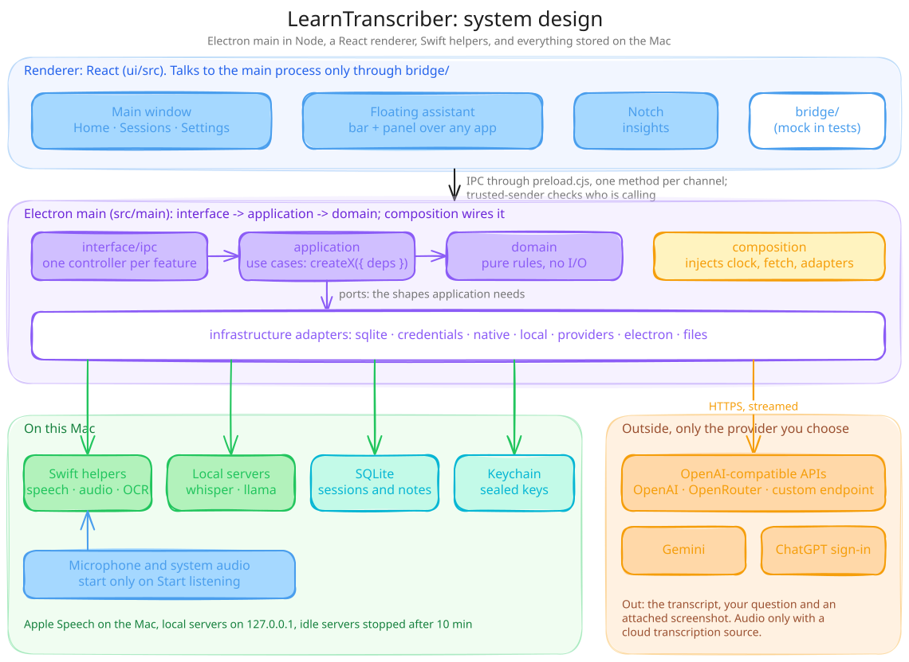

<p align="center">
  <picture>
    <source media="(prefers-color-scheme: dark)" srcset="docs/readme/wordmark-dark.svg">
    
  </picture>
</p>

<p align="center">
  
</p>

<h1 align="center">Read what you hear. Ask as you listen.</h1>

<p align="center">
  <b>English</b> · <a href="README.pt-BR.md">Português</a> · <a href="README.es.md">Español</a>
</p>

<p align="center">
  <strong>Live transcripts for lectures, videos and meetings on your Mac,<br>
  with a floating assistant you can ask about what was said.</strong><br>
  Free and open source. Speech can stay on your Mac with Apple Speech, answers come from the AI you choose, and every
  session is saved on your Mac.
</p>

<p align="center">
  <a href="LICENSE"></a>
  <a href="#requirements"></a>
  <a href="#requirements"></a>
  <a href="#how-it-works"></a>
</p>

<p align="center">
  <a href="https://github.com/DeVFirmino/learntranscriber/actions/workflows/ci.yml"></a>
  <a href="https://github.com/DeVFirmino/learntranscriber/actions/workflows/codeql.yml"></a>
  <a href="https://www.coderabbit.ai"></a>
  <a href="CONTRIBUTING.md"></a>
</p>

<p align="center">
  <a href="https://learntranscriber.danieldias.dev"></a>
  <a href="#get-it"></a>
  <a href="#install-with-your-agent"></a>
  <a href="#contributing"></a>
  <a href="https://buymeacoffee.com/dellphell"></a>
</p>

> **TL;DR** — A free, open-source Mac app that writes down what you hear in a class, a video or a meeting, live, and
> answers your questions about it in a floating panel. Speech can be transcribed entirely on your Mac with Apple
> Speech; answers come from the AI you choose: a ChatGPT sign-in, an API key, or a local model. For Apple Silicon Macs
> on macOS 14 or newer. Download it, install it with Homebrew, build it from source, or let your coding agent install
> it for you.

<p align="center">
  
</p>

https://github.com/user-attachments/assets/ec2e9893-6e2d-42a9-a7cd-04db263d3fdc

<p align="center">
  <b>Free and open source (MIT).</b> Read the code, open an issue or send a pull request: <a href="CONTRIBUTING.md">how to contribute</a>.
</p>

## Contents

- [What it does](#what-it-does)
- [Get it](#get-it)
- [Install with your agent](#install-with-your-agent)
- [First run](#first-run)
- [How it works](#how-it-works)
- [Assistants](#assistants)
- [Requirements](#requirements)
- [Build from source](#build-from-source)
- [Privacy](#privacy)
- [Keyboard shortcuts](#keyboard-shortcuts)
- [Contributing](#contributing)
- [FAQ](#faq)
- [Built with](#built-with)
- [Support and license](#support-and-license)

## What it does

- **Live transcript.** While a class, a meeting or a video plays, the words appear as people talk. They come from Apple
  Speech on the Mac, a local Whisper server, or a cloud transcription service, whichever you configure. Names and
  terms you add under **Vocabulary** help local Whisper and cloud transcription spell them right.
- **Ask about what was said.** A floating panel sits over any app. Ask a question and the answer streams back, grounded
  in the transcript. A screenshot or the text you have selected can go with the question.
- **Assistants for the moment.** English, Math, Programming, a Note Taker for meetings and a General assistant come
  with the app, and you can make your own.
- **Session history.** Reopen transcripts and answers, generate a summary, or save a Markdown note.
- **Answer providers.** Sign in with ChatGPT, use an API key for OpenAI, OpenRouter or Gemini, connect a custom
  OpenAI-compatible endpoint, or download and run a local model.

## Get it

[Download the latest DMG](https://github.com/DeVFirmino/learntranscriber/releases/latest/download/LearnTranscriber-arm64.dmg)
from [GitHub Releases](https://github.com/DeVFirmino/learntranscriber/releases/latest), for Apple Silicon Macs on
macOS 14 or newer, and drag LearnTranscriber to Applications.

The app is not notarized by Apple, so macOS blocks its first launch: open **System Settings → Privacy & Security**,
scroll to Security and choose **Open Anyway** next to LearnTranscriber, then confirm with your password
([Apple's instructions](https://support.apple.com/guide/mac-help/apple-cant-check-app-for-malicious-software-mchleab3a043/mac)).
When a new version is out, the Home banner downloads it and keeps it only if its SHA-256 matches the one the release
publishes; choose **Open installer** and drag LearnTranscriber over the previous copy. Your sessions and settings stay.

Or install it with [Homebrew](https://github.com/learntranscriber/homebrew-tap), which handles updates too:

<a href="https://github.com/learntranscriber/homebrew-tap"></a>

<details>
<summary>Copy the commands</summary>

```sh
brew tap learntranscriber/tap
brew trust learntranscriber/tap
brew install --cask learntranscriber
```

</details>

`brew trust` is Homebrew's one-time consent for a tap it does not maintain. The first launch still needs
**Open Anyway**; later versions come with `brew upgrade --cask learntranscriber`.

You can also [build it from source](#build-from-source) or let [your coding agent](#install-with-your-agent) install
it.

## Install with your agent

If you use a coding agent such as Claude Code or Codex, send it the link to this repository and ask it to install the
app, or paste this:

```text
Install LearnTranscriber on this Mac from https://github.com/DeVFirmino/learntranscriber.
Clone the repository and follow the "Build from source" section of its README: check that Xcode with the macOS 26 SDK
and Node.js 24 or newer are installed, run `npm ci` and `npm ci --prefix ui`, build the app with `npm run pack`, copy
dist/mac-arm64/LearnTranscriber.app to /Applications, and open it. If macOS blocks it, tell me so I can choose
Open Anyway in System Settings → Privacy & Security.
```

The agent can do everything but the first launch: there, macOS asks you for each permission and, for a build without a
Developer ID, for **Open Anyway**.

## First run

After the welcome screen, guided setup covers four areas. **Skip for now** closes setup, and **Continue setup** on
Home reopens it.

1. **Choose the AI that answers:** sign in with ChatGPT, paste an API key, or download a local model. The step checks
   the connection and picks a model before moving on.
2. **Set up listening:** test your microphone with a live level and choose an audio source and transcription engine.
   Setup defaults to computer audio alongside the microphone and on-device Apple Speech.
3. **Grant permissions:** setup guides you through the permissions required for your choices, one at a time.
4. **Try a session:** the floating bar and panel guide you through starting capture, getting a transcript and asking
   a question. If setup is incomplete, you can play a sample conversation.

## How it works

<p align="center">
  
</p>

The app is an Electron main process written in Node, a React renderer, and a set of small Swift helpers.

- **Renderer** (`ui/src`): the main window (Home, Sessions, Settings), the floating assistant (a bar and a panel over
  any app) and the Notch. It reaches the main process only through `bridge/`, which maps one method per IPC channel in
  `src/main/preload.cjs`; tests run the same screens against a mock bridge.
- **Main process** (`src/main`): `interface/ipc` has one thin controller per feature, `application` holds the use cases
  as `createX({ deps })` factories, and `domain` holds pure rules with no I/O. `infrastructure` adapters touch the
  world (SQLite, the Keychain, the native helpers, local servers, providers), and `composition` wires everything and
  injects the clock, `fetch` and the adapters. The full contract is in [AGENTS.md](AGENTS.md).
- **Swift helpers** (`native/`): Apple Speech for on-device transcription, ScreenCaptureKit and Core Audio for the
  computer's audio, and Vision for text on the screen. Each is a small command the main process spawns and talks to
  over stdin and stdout.
- **On the Mac**: sessions and notes in SQLite inside the app's Application Support folder, provider keys sealed with
  Electron's `safeStorage` (the macOS Keychain), and optional `whisper-server` / `llama-server` processes bound to
  `127.0.0.1`.
- **Outside**: only the services you chose. Audio leaves the Mac only with a cloud transcription source.

A session, step by step:

1. Pick an assistant in the floating bar.
2. Press **Start listening** (⌘D). The microphone, and the computer's audio if you enabled it, start only now, and the
   transcript fills in as people talk.
3. Ask in the floating panel (⌘Return). The transcript, your question and, if you attached one, a screenshot (⌘E) or
   selected text (⌘⇧K) go to your answer provider, and the answer streams back.
4. Stop listening. The session keeps its transcript and answers in Sessions, where you can generate a summary or save
   a Markdown note.

## Assistants

<p align="center">
  
</p>

| Assistant | Category | What it does |
| --- | --- | --- |
| English Assistant | Education | Explains grammar, vocabulary and clearer phrasing. |
| Math Assistant | Education | Works through problems step by step, from school to lectures. |
| Programming Assistant | Education | Explains code and concepts, with examples you can run. |
| Note Taker | Meetings | Keeps decisions, action items and open questions as the meeting goes. |
| General Assistant | General | Explains any topic, from a quick summary down to the details. |

Those five come with the app. Your own assistants are made on the Assistants page with a name, a category and one
prompt, and they appear in the floating bar next to the built-in ones.

## Requirements

- A Mac with Apple Silicon running macOS 14 or newer. Builds are arm64 only. Installing or releasing Apple Speech
  language assets needs macOS 26.
- Microphone access for voice capture, Speech Recognition for Apple Speech, and Screen & System Audio Recording for
  display capture. Reading selected text from other apps can require Accessibility access.
- A configured answer provider for questions and summaries.
- [Homebrew](https://brew.sh), only if you want the app to install `llama-server` or `whisper-server` for you.

The app checks GitHub for new releases. The Home banner downloads one to your Downloads folder and keeps it only if
its SHA-256 matches the release's checksum; you then install it over the previous build, and your sessions and settings
stay. A Homebrew install updates with `brew upgrade --cask learntranscriber`.

## Build from source

1. **Install Xcode** with the macOS 26 SDK and Swift 6.2 or newer. Matching Command Line Tools suffice to build
   the helpers. Use Xcode to run the Swift tests.
2. **Install Node.js** 24 or newer. The build and test tools run on Node.js, and the backend tests use its built-in
   SQLite module.
3. **Clone this repository** and install both sets of dependencies:

   ```sh
   npm ci
   npm ci --prefix ui
   ```

4. **Run it:**

   ```sh
   npm start
   ```

   This builds the renderer and the Swift helpers, then opens the app.

5. **Package it** when you want it outside the dev flow:

   ```sh
   npm run pack   # dist/mac-arm64/LearnTranscriber.app
   npm run dmg    # dist/distribution-local/LearnTranscriber-<version>-arm64-local.dmg
   npm run sbom   # dist/LearnTranscriber-<version>-sbom.cdx.json, the components the app ships
   ```

   Both are personal builds: no Developer ID signature, no notarization. Packaging prefers an installed Apple
   Development certificate, then a local self-signed identity, then unsigned; see
   [local signing](docs/local-signing.md).

6. **Open your build.** If Gatekeeper blocks it, follow
   [Apple's instructions for opening an app](https://support.apple.com/guide/mac-help/apple-cant-check-app-for-malicious-software-mchleab3a043/mac)
   using **System Settings → Privacy & Security → Open Anyway**.

## Privacy

- A listening session captures the enabled audio sources. Hiding the windows leaves capture running. Use **Stop
  listening** to stop it. The microphone tests in setup and Settings open the mic to show a live level.
- Apple Speech and local Whisper transcribe audio on the Mac. Cloud transcription sends audio to the selected service.
- Answer requests can send transcript context, selected text or screenshots to the configured provider. **Quick
  screenshot analysis** is on by default and sends a screenshot when you capture one. Automatic screen analysis can
  send a screenshot at session start or after a selection. **Analyze copied selections**, on by default, can send
  copied text that matches a selection in another app during a session. Remote endpoints use HTTPS; local endpoints
  can use HTTP on loopback.
- Provider keys are encrypted with Electron's `safeStorage`, backed by the macOS Keychain, and the app's screens can
  save a key but never read one back.
- Sessions and settings live in a local SQLite database in the app's Application Support folder, readable only by
  your macOS user. The app does not encrypt it: FileVault encrypts the disk, and backups such as Time Machine keep
  their own copies.
- Errors and warnings go to a log in `~/Library/Logs/LearnTranscriber`, readable only by your user and kept to two
  files. Common key and token formats are redacted, but read a log before you share it.
- The app asks GitHub whether a newer release exists at most once a day, starting about 15 seconds after launch. The
  request carries the app version and, like any request, your IP address; it sends no transcript, setting or key.
- An update downloads only when you choose **Download** in that banner: the DMG and its checksum come from this
  repository's release, go to your Downloads folder, and a DMG that fails SHA-256 verification is deleted.
- Downloading a local model from Hugging Face, a server runtime through Homebrew or an Apple Speech language uses the
  network.
- Managed `whisper-server` and `llama-server` processes bind to `127.0.0.1` and stop after 10 idle minutes.
  `llama-server` requires a per-launch API key; `whisper-server` has no authentication option, so it depends on
  staying on loopback only. Model downloads that fail SHA-256 verification are discarded.
- Capture protection is enabled by default. Apps using ScreenCaptureKit can still capture a protected window
  ([Electron documents this](https://www.electronjs.org/docs/latest/api/browser-window#winsetcontentprotectionenable-macos-windows)).
  Share one window rather than the whole display, and check what attendees see.

## Keyboard shortcuts

Change these default global shortcuts in Settings → Shortcuts.

| Shortcut | Action |
| --- | --- |
| ⌘D | Start listening / analyze the conversation (also brings back hidden windows) |
| ⌘Return | Ask / submit a question |
| ⌘E | Capture the screen |
| ⌘⇧K | Read selected text |
| ⌘⇧D | Mute / unmute the microphone |
| ⌘B | Hide / restore all windows |
| ⌘M | Toggle the floating assistant |
| ⌘⇧I | Toggle click-through |

## Contributing

LearnTranscriber is open source, and contributions of every size are welcome: a bug report, a translation, a better
assistant, a clearer doc or a pull request. [CONTRIBUTING.md](CONTRIBUTING.md) has the details, and vulnerabilities go
privately through [SECURITY.md](SECURITY.md), never into a public issue.

### Ways to help

- **Report a bug.** Open an issue with your macOS version and Mac model, the steps, what you expected and what
  happened, and the relevant lines of `~/Library/Logs/LearnTranscriber/main.log` with anything private removed.
- **Suggest a feature.** Open an issue that describes when you would use it. For anything bigger than a small fix,
  agree on the change in the issue before you build it.
- **Translate the app.** Every text the app shows lives in [`ui/src/locales/`](ui/src/locales) (`en`, `pt-BR`, `es`).
  The catalogs keep the same keys, which [`ui/test/i18n.test.cjs`](ui/test/i18n.test.cjs) checks; a new language is a
  new catalog with every key.
- **Improve an assistant.** The [built-in assistants](src/main/domain/assistants/built-ins) live in one file each.
- **Make the docs clearer.** This README and its [Portuguese](README.pt-BR.md) and [Spanish](README.es.md) versions,
  [CONTRIBUTING.md](CONTRIBUTING.md), the
  [feature inventory](docs/features.md), the [design system](docs/design-system.md) and the
  [UI integration notes](docs/UI_INTEGRATION.md).

### Project layout

```
src/main/      Electron main process: domain, application, infrastructure, interface/ipc, composition
ui/src/        React renderer: pages, features, components, settings, locales; bridge/ is the only Electron contact
native/        Swift helpers: HelperKit, CommandKit, <Area>Core, <Area>Adapters, one thin command each
test/, ui/test/, native/Tests/   node:test, node:test over transpiled TS, Swift Testing
docs/          feature inventory, design notes and verification reports
```

Read [AGENTS.md](AGENTS.md) before your first change. It is the project's contract: dependencies point
`interface → application → domain`, modules receive what they use instead of importing it, each module has one
responsibility in roughly 150 lines, schema changes are numbered migrations, and every new module ships with a focused
test.

### Before you open a pull request

```sh
npm test          # backend
npm run ui:test   # renderer logic
npm run check     # syntax, prettier, oxlint
npm run ui:build  # tsc + vite
```

When `native/` changed, also run `cd native && swift build -c release && swift test`. Keep each commit to one concern
with a short imperative subject, and in the pull request say what changes and how you checked it, with before-and-after
screenshots for anything visual.

## FAQ

**Is it free?** The app is free and MIT-licensed. Answers come from the AI you connect: a ChatGPT plan you already
have, an API key the provider bills per use, or a local model that costs nothing.

**Does my audio leave my Mac?** Only with a cloud transcription source. Apple Speech and local Whisper transcribe on
the Mac.

**What does a question send?** The transcript, your question and anything you attached go to your answer provider,
unless that provider is a local model. See [Privacy](#privacy) for the screenshot and selection defaults.

**Does it work on Intel Macs or Windows?** No. Builds are for Apple Silicon Macs on macOS 14 or newer.

**Can people on a call see it when I share my screen?** They might: capture protection does not stop ScreenCaptureKit
(see [Privacy](#privacy)), so share a single window when you can.

## Built with

[Electron](https://www.electronjs.org), [React](https://react.dev), [Vite](https://vite.dev),
[Tailwind CSS](https://tailwindcss.com), [Radix UI](https://www.radix-ui.com) and [shadcn/ui](https://ui.shadcn.com),
[Lucide](https://lucide.dev) icons, [react-markdown](https://github.com/remarkjs/react-markdown),
[highlight.js](https://highlightjs.org), [PDF.js](https://mozilla.github.io/pdf.js/),
[Sonner](https://sonner.emilkowal.ski) and the [Geist](https://vercel.com/font) typeface.
[whisper.cpp](https://github.com/ggml-org/whisper.cpp) and [llama.cpp](https://github.com/ggml-org/llama.cpp) run the
local models, [webrtcaec3.js](https://github.com/ennuicastr/webrtcaec3.js) brings WebRTC's echo canceller, and Apple's
Speech, ScreenCaptureKit and Vision frameworks do the on-device work.

## Support and license

If LearnTranscriber helps you study or work, star the repository, tell a friend, or
[buy me a coffee](https://buymeacoffee.com/dellphell). LearnTranscriber is released under the [MIT License](LICENSE).

<p align="center">
  <a href="https://danieldias.dev"></a>
</p>

<p align="center">
  <a href="https://learntranscriber.danieldias.dev">learntranscriber.danieldias.dev</a> ·
  <a href="https://danieldias.dev">danieldias.dev</a> · <a href="https://github.com/DeVFirmino">GitHub</a>
</p>
