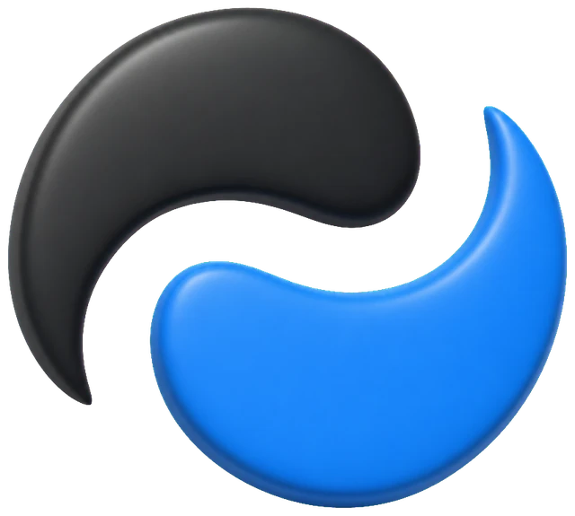
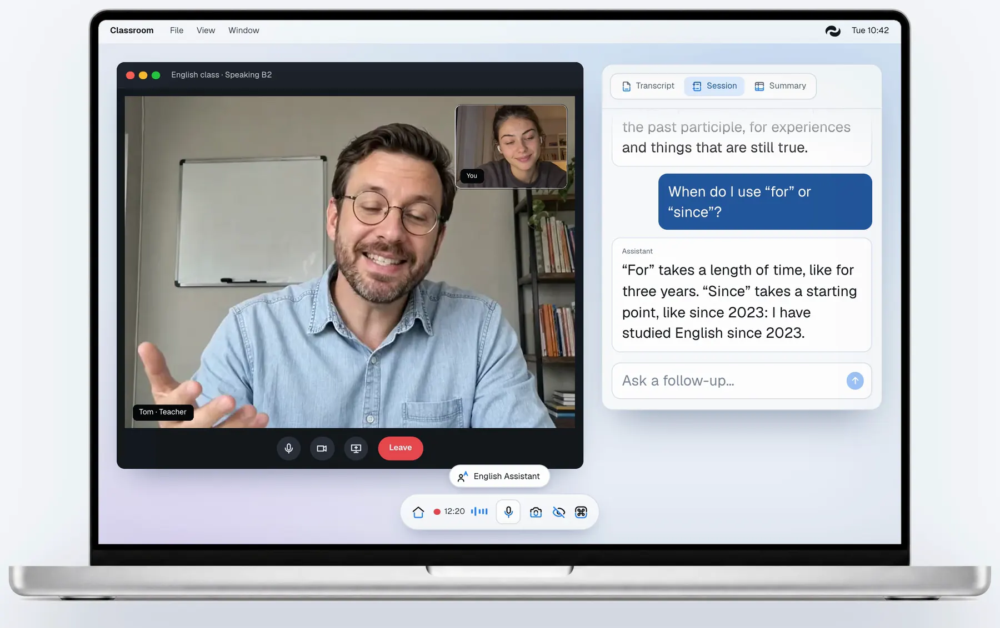
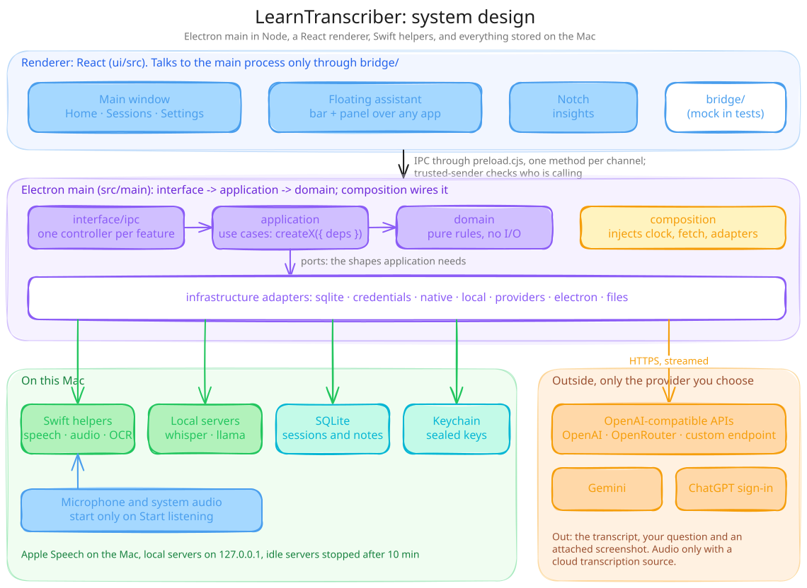

<p align="center">
  <picture>
    <source media="(prefers-color-scheme: dark)" srcset="docs/readme/wordmark-dark.svg">
    
  </picture>
</p>

<p align="center">
  
</p>

<h1 align="center">Leia o que você ouve. Pergunte enquanto escuta.</h1>

<p align="center">
  <a href="README.md">English</a> · <b>Português</b> · <a href="README.es.md">Español</a>
</p>

<p align="center">
  <strong>Transcrição ao vivo de aulas, vídeos e reuniões no seu Mac,<br>
  com um assistente flutuante para perguntar sobre o que foi dito.</strong><br>
  Gratuito e de código aberto. A fala pode ficar no seu Mac com o Apple Speech, as respostas vêm da IA que você
  escolher e cada sessão fica salva no seu Mac.
</p>

<p align="center">
  <a href="LICENSE"></a>
  <a href="#requisitos"></a>
  <a href="#requisitos"></a>
  <a href="#como-funciona"></a>
</p>

<p align="center">
  <a href="https://github.com/DeVFirmino/learntranscriber/actions/workflows/ci.yml"></a>
  <a href="https://github.com/DeVFirmino/learntranscriber/actions/workflows/codeql.yml"></a>
  <a href="https://www.coderabbit.ai"></a>
  <a href="CONTRIBUTING.md"></a>
</p>

<p align="center">
  <a href="https://learntranscriber.danieldias.dev"></a>
  <a href="#baixar"></a>
  <a href="#instalar-com-o-seu-agente"></a>
  <a href="#como-contribuir"></a>
  <a href="https://buymeacoffee.com/dellphell"></a>
</p>

> **Resumo** — Um app gratuito e de código aberto para Mac que escreve, ao vivo, o que você ouve numa aula, num vídeo
> ou numa reunião, e responde às suas perguntas sobre isso num painel flutuante. A fala pode ser transcrita
> inteiramente no seu Mac com o Apple Speech; as respostas vêm da IA que você escolher: o login do ChatGPT, uma chave
> de API ou um modelo local. Para Macs com Apple Silicon no macOS 14 ou mais recente. Baixe o app, compile a partir do
> código ou deixe o seu agente de programação instalar para você.

<p align="center">
  
</p>

<sub>Esta é uma tradução do [README em inglês](README.md). Se algo divergir, vale o inglês.</sub>

## Conteúdo

- [O que ele faz](#o-que-ele-faz)
- [Baixar](#baixar)
- [Instalar com o seu agente](#instalar-com-o-seu-agente)
- [Primeiro uso](#primeiro-uso)
- [Como funciona](#como-funciona)
- [Assistentes](#assistentes)
- [Requisitos](#requisitos)
- [Compilar a partir do código](#compilar-a-partir-do-código)
- [Privacidade](#privacidade)
- [Atalhos de teclado](#atalhos-de-teclado)
- [Como contribuir](#como-contribuir)
- [Perguntas frequentes](#perguntas-frequentes)
- [Feito com](#feito-com)
- [Apoio e licença](#apoio-e-licença)

## O que ele faz

- **Transcrição ao vivo.** Enquanto uma aula, uma reunião ou um vídeo acontece, as palavras aparecem conforme as
  pessoas falam. Elas vêm do Apple Speech no Mac, de um servidor Whisper local ou de um serviço de transcrição na
  nuvem, o que você configurar.
- **Pergunte sobre o que foi dito.** Um painel flutuante fica sobre qualquer app. Faça uma pergunta e a resposta chega
  aos poucos, com base na transcrição. Uma captura de tela ou o texto que você selecionou pode ir junto com a pergunta.
- **Um assistente para cada momento.** Inglês, Matemática, Programação, um anotador para reuniões e um assistente
  geral vêm com o app, e você pode criar os seus.
- **Histórico de sessões.** Reabra transcrições e respostas, gere um resumo ou salve uma nota em Markdown.
- **Provedores de respostas.** Entre com o ChatGPT, use uma chave de API da OpenAI, da OpenRouter ou do Gemini, conecte
  um endpoint próprio compatível com a OpenAI, ou baixe e rode um modelo local.

## Baixar

[Baixe o DMG mais recente](https://github.com/DeVFirmino/learntranscriber/releases/latest/download/LearnTranscriber-arm64.dmg)
no [GitHub Releases](https://github.com/DeVFirmino/learntranscriber/releases/latest), para Macs com Apple Silicon no
macOS 14 ou mais recente, e arraste o LearnTranscriber para Aplicativos.

O app não é notarizado pela Apple, então o macOS bloqueia a primeira abertura: abra **Ajustes do Sistema →
Privacidade e Segurança**, role até Segurança, escolha **Abrir Mesmo Assim** ao lado do LearnTranscriber e confirme
com a sua senha ([instruções da Apple](https://support.apple.com/pt-br/guide/mac-help/mchleab3a043/mac)). Quando sai uma
versão nova, o banner do Início baixa e só guarda o arquivo se o SHA-256 bater com o que a versão publica; escolha
**Abrir instalador** e arraste o LearnTranscriber por cima da cópia anterior. Suas sessões e configurações continuam.

Ou instale pelo [Homebrew](https://github.com/learntranscriber/homebrew-tap), que também cuida das atualizações:

```sh
brew tap learntranscriber/tap
brew trust learntranscriber/tap
brew install --cask learntranscriber
```

`brew trust` é a autorização que o Homebrew pede uma vez para um tap que não é dele. A primeira abertura ainda pede
**Abrir Mesmo Assim**; as versões seguintes chegam com `brew upgrade --cask learntranscriber`.

Você também pode [compilar a partir do código](#compilar-a-partir-do-código) ou deixar
[o seu agente de programação](#instalar-com-o-seu-agente) instalar o app.

## Instalar com o seu agente

Se você usa um agente de programação como o Claude Code ou o Codex, mande para ele o link deste repositório e peça
para instalar o app, ou cole isto:

```text
Instale o LearnTranscriber neste Mac a partir de https://github.com/DeVFirmino/learntranscriber.
Clone o repositório e siga a seção "Compilar a partir do código" do README.pt-BR.md: confira se o Xcode com o SDK do
macOS 26 e o Node.js 24 ou mais recente estão instalados, rode `npm ci` e `npm ci --prefix ui`, compile o app com
`npm run pack`, copie dist/mac-arm64/LearnTranscriber.app para /Applications e abra o app. Se o macOS bloquear, me
avise para eu escolher Abrir Mesmo Assim em Ajustes do Sistema → Privacidade e Segurança.
```

O agente faz tudo menos a primeira abertura: nela, o macOS pede a você cada permissão e, num build sem Developer ID, o
**Abrir Mesmo Assim**.

## Primeiro uso

Depois da tela de boas-vindas, a configuração guiada passa por quatro etapas. **Pular por enquanto** fecha a
configuração, e **Continuar configuração** no Início a reabre.

1. **Escolha a IA que responde:** entre com o ChatGPT, cole uma chave de API ou baixe um modelo local. A etapa testa a
   conexão e escolhe um modelo antes de seguir.
2. **Configure a escuta:** teste o microfone com o nível ao vivo e escolha uma fonte de áudio e um mecanismo de
   transcrição. A configuração já vem com o áudio do computador junto com o microfone e com o Apple Speech no próprio
   Mac.
3. **Conceda as permissões:** a configuração guia você pelas permissões que as suas escolhas exigem, uma de cada vez.
4. **Experimente uma sessão:** a barra e o painel flutuantes mostram como começar a captura, ver a transcrição e fazer
   uma pergunta. Se a configuração estiver incompleta, você pode tocar uma conversa de exemplo.

## Como funciona

<p align="center">
  
</p>

O app é um processo principal Electron escrito em Node, um renderer React e um conjunto de pequenos helpers em Swift.

- **Renderer** (`ui/src`): a janela principal (Início, Sessões, Configurações), o assistente flutuante (uma barra e um
  painel sobre qualquer app) e o Notch. Ele só fala com o processo principal pelo `bridge/`, que tem um método para
  cada canal de IPC em `src/main/preload.cjs`; os testes rodam as mesmas telas com um bridge simulado.
- **Processo principal** (`src/main`): `interface/ipc` tem um controller enxuto por funcionalidade, `application`
  guarda os casos de uso como factories `createX({ deps })` e `domain` guarda regras puras, sem I/O. Os adaptadores de
  `infrastructure` tocam o mundo (o SQLite, o Keychain, os helpers nativos, os servidores locais, os provedores), e
  `composition` liga tudo e injeta o relógio, o `fetch` e os adaptadores. O contrato completo está no
  [AGENTS.md](AGENTS.md).
- **Helpers em Swift** (`native/`): o Apple Speech para transcrever no próprio Mac, o ScreenCaptureKit e o Core Audio
  para o áudio do computador e o Vision para o texto na tela. Cada um é um comando pequeno que o processo principal
  inicia e com quem conversa por stdin e stdout.
- **No Mac**: sessões e notas em SQLite dentro da pasta Application Support do app, chaves dos provedores protegidas
  pelo `safeStorage` do Electron (o Keychain do macOS) e, se você quiser, processos `whisper-server` /
  `llama-server` ligados a `127.0.0.1`.
- **Fora do Mac**: só os serviços que você escolheu. O áudio só sai do Mac com uma fonte de transcrição na nuvem.

Uma sessão, passo a passo:

1. Escolha um assistente na barra flutuante.
2. Aperte **Começar a ouvir** (⌘D). O microfone, e o áudio do computador se você o ativou, só começam agora, e a
   transcrição vai se preenchendo conforme as pessoas falam.
3. Pergunte no painel flutuante (⌘Return). A transcrição, a sua pergunta e, se você anexou, uma captura de tela (⌘E) ou
   um texto selecionado (⌘⇧K) vão para o seu provedor de respostas, e a resposta chega aos poucos.
4. Pare de ouvir. A sessão guarda a transcrição e as respostas em Sessões, onde você pode gerar um resumo ou salvar uma
   nota em Markdown.

## Assistentes

<p align="center">
  
</p>

| Assistente | Categoria | O que faz |
| --- | --- | --- |
| English Assistant | Educação | Explica gramática, vocabulário e formas mais claras de dizer algo. |
| Math Assistant | Educação | Resolve problemas passo a passo, da escola à faculdade. |
| Programming Assistant | Educação | Explica código e conceitos, com exemplos que você pode rodar. |
| Note Taker | Reuniões | Registra decisões, tarefas e perguntas em aberto durante a reunião. |
| General Assistant | Geral | Explica qualquer assunto, de um resumo rápido até os detalhes. |

Esses cinco vêm com o app. Os seus assistentes são criados na página Assistentes com um nome, uma categoria e um
prompt, e aparecem na barra flutuante ao lado dos que vêm com o app.

## Requisitos

- Um Mac com Apple Silicon no macOS 14 ou mais recente. Os builds são só arm64. Instalar ou liberar idiomas do Apple
  Speech exige o macOS 26.
- Acesso a Microfone para captar a voz, a Reconhecimento de Fala para o Apple Speech e a Gravação de Tela e Áudio do
  Sistema para captar a tela. Ler texto selecionado em outros apps pode exigir acesso de Acessibilidade.
- Um provedor de respostas configurado para perguntas e resumos.
- [Homebrew](https://brew.sh), só se você quiser que o app instale o `llama-server` ou o `whisper-server` para você.

O app verifica no GitHub se há versões novas. Instale as atualizações manualmente, por cima do build anterior, para
manter suas sessões e configurações.

## Compilar a partir do código

1. **Instale o Xcode** com o SDK do macOS 26 e o Swift 6.2 ou mais recente. As Command Line Tools correspondentes
   bastam para compilar os helpers. Use o Xcode para rodar os testes em Swift.
2. **Instale o Node.js** 24 ou mais recente. As ferramentas de build e de teste rodam no Node.js, e os testes do
   backend usam o módulo SQLite que vem com ele.
3. **Clone este repositório** e instale os dois conjuntos de dependências:

   ```sh
   npm ci
   npm ci --prefix ui
   ```

4. **Rode o app:**

   ```sh
   npm start
   ```

   Isso compila o renderer e os helpers em Swift e depois abre o app.

5. **Empacote** quando quiser usar o app fora do fluxo de desenvolvimento:

   ```sh
   npm run pack   # dist/mac-arm64/LearnTranscriber.app
   npm run dmg    # dist/distribution-local/LearnTranscriber-<versão>-arm64-local.dmg
   npm run sbom   # dist/LearnTranscriber-<versão>-sbom.cdx.json, a lista do que vai dentro do app
   ```

   Os dois builds são pessoais: sem assinatura Developer ID e sem notarização. O empacotamento usa primeiro um
   certificado Apple Development instalado, depois uma identidade local autoassinada e, por último, nenhuma
   assinatura; veja a [assinatura local](docs/local-signing.md).

6. **Abra o seu build.** Se o Gatekeeper bloquear, siga as
   [instruções da Apple para abrir um app](https://support.apple.com/pt-br/guide/mac-help/mchleab3a043/mac) usando
   **Ajustes do Sistema → Privacidade e Segurança → Abrir Mesmo Assim**.

## Privacidade

- Uma sessão de escuta capta as fontes de áudio ativadas. Ocultar as janelas deixa a captura rodando; use **Parar de
  ouvir** para pará-la. Os testes de microfone na configuração e em Configurações abrem o microfone para mostrar o
  nível ao vivo.
- O Apple Speech e o Whisper local transcrevem o áudio no Mac. A transcrição na nuvem envia o áudio para o serviço
  escolhido.
- Os pedidos de resposta podem enviar trechos da transcrição, texto selecionado ou capturas de tela para o provedor
  configurado. A **Análise rápida de captura** vem ligada e envia uma captura quando você tira uma. A análise automática
  da tela pode enviar uma captura no início da sessão ou depois de uma seleção. **Analisar seleções copiadas**, ligada
  por padrão, pode enviar o texto copiado que corresponda a uma seleção em outro app durante uma sessão. Endpoints
  remotos usam HTTPS; endpoints locais podem usar HTTP no loopback.
- As chaves dos provedores são criptografadas com o `safeStorage` do Electron, apoiado no Keychain do macOS, e as
  telas do app podem salvar uma chave, mas nunca lê-la de volta.
- Sessões e configurações ficam num banco SQLite local, na pasta Application Support do app, que só o seu usuário do
  macOS consegue ler. O app não o criptografa: o FileVault criptografa o disco, e backups como o Time Machine guardam
  as próprias cópias.
- Erros e avisos vão para um log em `~/Library/Logs/LearnTranscriber`, que só o seu usuário consegue ler e que fica
  limitado a dois arquivos. Formatos comuns de chaves e tokens são ocultados, mas leia o log antes de compartilhá-lo.
- O app pergunta ao GitHub se existe uma versão nova no máximo uma vez por dia, começando uns 15 segundos depois de
  abrir. O pedido leva a versão do app e, como qualquer pedido, o seu endereço IP; não envia transcrição, configuração
  nem chave.
- Baixar um modelo local do Hugging Face, um servidor pelo Homebrew ou um idioma do Apple Speech usa a rede.
- Os processos `whisper-server` e `llama-server` gerenciados pelo app ficam ligados a `127.0.0.1` e param depois de 10
  minutos sem uso. O `llama-server` exige uma chave de API nova a cada vez que abre; o `whisper-server` não tem opção
  de autenticação, então depende de ficar só no loopback. Downloads de modelos que falham na verificação SHA-256 são
  descartados.
- A proteção contra captura vem ligada. Apps que usam o ScreenCaptureKit ainda conseguem capturar uma janela protegida
  ([o Electron documenta isso](https://www.electronjs.org/docs/latest/api/browser-window#winsetcontentprotectionenable-macos-windows)).
  Compartilhe uma janela em vez da tela inteira e confira o que os participantes estão vendo.

## Atalhos de teclado

Mude estes atalhos globais em Configurações → Atalhos.

| Atalho | Ação |
| --- | --- |
| ⌘D | Iniciar escuta / analisar conversa |
| ⌘Return | Perguntar / enviar pergunta |
| ⌘E | Capturar tela |
| ⌘⇧K | Ler texto selecionado |
| ⌘⇧D | Silenciar / ativar microfone |
| ⌘B | Ocultar / restaurar todas as janelas |
| ⌘M | Mostrar/ocultar assistente flutuante |
| ⌘⇧I | Ligar/desligar clique através |

## Como contribuir

O LearnTranscriber é de código aberto, e contribuições de todo tamanho são bem-vindas: um relato de bug, uma tradução,
um assistente melhor, uma documentação mais clara ou um pull request. O [CONTRIBUTING.md](CONTRIBUTING.md) tem os
detalhes, e vulnerabilidades vão de forma privada pelo [SECURITY.md](SECURITY.md), nunca numa issue pública.

### Formas de ajudar

- **Relate um bug.** Abra uma issue com a versão do macOS e o modelo do Mac, os passos, o que você esperava e o que
  aconteceu, e as linhas relevantes de `~/Library/Logs/LearnTranscriber/main.log`, sem nada privado.
- **Sugira uma funcionalidade.** Abra uma issue contando quando você usaria. Para algo maior que uma correção pequena,
  combine a mudança na issue antes de construí-la.
- **Traduza o app.** Todo texto que o app mostra fica em [`ui/src/locales/`](ui/src/locales) (`en`, `pt-BR`, `es`).
  Os catálogos mantêm as mesmas chaves, o que o [`ui/test/i18n.test.cjs`](ui/test/i18n.test.cjs) confere; um idioma
  novo é um catálogo novo com todas as chaves.
- **Melhore um assistente.** Os [assistentes que vêm com o app](src/main/domain/assistants/built-ins) ficam num arquivo
  cada.
- **Deixe a documentação mais clara.** Este README e as versões em [inglês](README.md) e [espanhol](README.es.md), o
  [CONTRIBUTING.md](CONTRIBUTING.md), o [inventário de funcionalidades](docs/features.md), o
  [design system](docs/design-system.md) e as [notas de integração da UI](docs/UI_INTEGRATION.md).

### Estrutura do projeto

```
src/main/      processo principal Electron: domain, application, infrastructure, interface/ipc, composition
ui/src/        renderer React: pages, features, components, settings, locales; bridge/ é o único contato com o Electron
native/        helpers em Swift: HelperKit, CommandKit, <Area>Core, <Area>Adapters, um comando enxuto cada
test/, ui/test/, native/Tests/   node:test, node:test sobre TS transpilado, Swift Testing
docs/          inventário de funcionalidades, notas de design e relatórios de verificação
```

Leia o [AGENTS.md](AGENTS.md) antes da sua primeira mudança. Ele é o contrato do projeto: as dependências apontam
`interface → application → domain`, os módulos recebem o que usam em vez de importar, cada módulo tem uma
responsabilidade em cerca de 150 linhas, mudanças de schema são migrations numeradas e todo módulo novo vem com um
teste focado.

### Antes de abrir um pull request

```sh
npm test          # backend
npm run ui:test   # lógica do renderer
npm run check     # sintaxe, prettier, oxlint
npm run ui:build  # tsc + vite
```

Se o `native/` mudou, rode também `cd native && swift build -c release && swift test`. Mantenha cada commit num assunto
só, com um título curto em inglês, no imperativo, e no pull request diga o que muda e como você conferiu, com capturas
de antes e depois para qualquer mudança visual.

## Perguntas frequentes

**É gratuito?** O app é gratuito e tem licença MIT. As respostas vêm da IA que você conectar: um plano do ChatGPT que
você já tem, uma chave de API que o provedor cobra por uso, ou um modelo local, que não custa nada.

**Meu áudio sai do meu Mac?** Só com uma fonte de transcrição na nuvem. O Apple Speech e o Whisper local transcrevem
no Mac.

**O que uma pergunta envia?** A transcrição, a sua pergunta e o que você anexou vão para o seu provedor de respostas, a
não ser que ele seja um modelo local. Veja [Privacidade](#privacidade) para os padrões de captura de tela e de seleção.

**Funciona em Macs Intel ou no Windows?** Não. Os builds são para Macs com Apple Silicon no macOS 14 ou mais recente.

**As pessoas numa chamada conseguem ver o app quando eu compartilho a tela?** Podem: a proteção contra captura não
impede o ScreenCaptureKit (veja [Privacidade](#privacidade)), então compartilhe só uma janela quando puder.

## Feito com

[Electron](https://www.electronjs.org), [React](https://react.dev), [Vite](https://vite.dev),
[Tailwind CSS](https://tailwindcss.com), [Radix UI](https://www.radix-ui.com) e [shadcn/ui](https://ui.shadcn.com),
ícones [Lucide](https://lucide.dev), [react-markdown](https://github.com/remarkjs/react-markdown),
[highlight.js](https://highlightjs.org), [PDF.js](https://mozilla.github.io/pdf.js/),
[Sonner](https://sonner.emilkowal.ski) e a fonte [Geist](https://vercel.com/font).
O [whisper.cpp](https://github.com/ggml-org/whisper.cpp) e o [llama.cpp](https://github.com/ggml-org/llama.cpp) rodam
os modelos locais, o [webrtcaec3.js](https://github.com/ennuicastr/webrtcaec3.js) traz o cancelador de eco do WebRTC, e
os frameworks Speech, ScreenCaptureKit e Vision da Apple fazem o trabalho no próprio Mac.

## Apoio e licença

Se o LearnTranscriber ajuda você a estudar ou a trabalhar, dê uma estrela no repositório, conte para alguém ou
[me pague um café](https://buymeacoffee.com/dellphell). O LearnTranscriber é distribuído sob a
[Licença MIT](LICENSE).

<p align="center">
  <a href="https://danieldias.dev"></a>
</p>

<p align="center">
  <a href="https://learntranscriber.danieldias.dev">learntranscriber.danieldias.dev</a> ·
  <a href="https://danieldias.dev">danieldias.dev</a> · <a href="https://github.com/DeVFirmino">GitHub</a>
</p>
